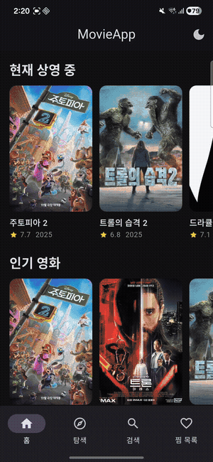
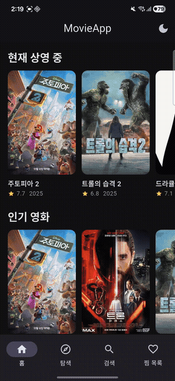
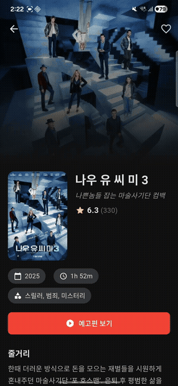
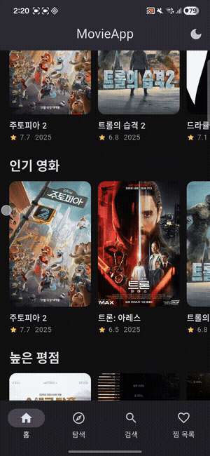

# Movie App

Flutter로 개발한 영화 정보 앱입니다. TMDB API를 활용하여 영화 정보를 제공합니다.

## Features

- 현재 상영작, 인기 영화, 평점 높은 영화, 개봉 예정작 조회
- 장르별 영화 탐색 (무한 스크롤)
- 영화 검색 (디바운싱 적용)
- 영화 상세 정보 및 출연진 확인
- 예고편 재생 (YouTube)
- 즐겨찾기 (로컬 저장)
- 다크/라이트 모드 지원
- Hero 애니메이션

## Screenshots

### 메인 화면


### Hero 애니메이션


### 검색


### 탐색


### 예고편


### 즐겨찾기


## Tech Stack

- **Framework**: Flutter
- **State Management**: Riverpod
- **Navigation**: go_router
- **HTTP Client**: Dio
- **Local Storage**: Hive
- **Image Caching**: cached_network_image

## Architecture

```
lib/
├── core/
│   └── constants/      # API 상수
├── models/             # 데이터 모델
├── providers/          # Riverpod providers
├── screens/            # 화면 UI
├── services/           # API 서비스
└── widgets/            # 공통 위젯
```

## Download

[APK 다운로드](https://github.com/jeongwon-dev01/movie_app/releases/latest)

## Build

```bash
# 의존성 설치
flutter pub get

# 실행 (API 키 필요)
flutter run --dart-define=TMDB_API_KEY=your_api_key

# APK 빌드
flutter build apk --dart-define=TMDB_API_KEY=your_api_key
```

## License

MIT License
